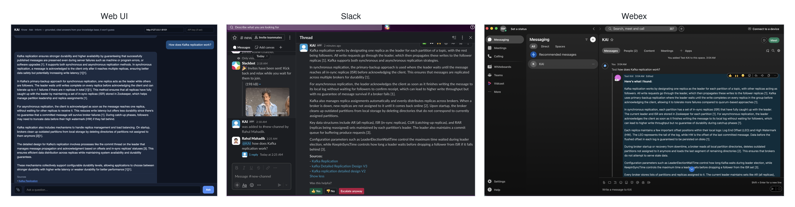

# KAI, a knowledge assistant that never guesses

[](https://github.com/rahulmahadik/kai-rag/actions/workflows/ci.yml)
[](LICENSE)

[](https://github.com/astral-sh/ruff)


> ### Ask your docs. Get a cited answer, or an honest "I don't know."



**KAI: Know, Ask, Inform.** A self-hosted knowledge assistant for your team's
documentation. Every confident answer is drawn from, and cites, your own
documents. When those documents do not support an answer, KAI escalates to a
human instead of inventing one.

It indexes Confluence spaces, PDFs, and text/markdown files into Postgres with
pgvector, and talks to any OpenAI-compatible LLM and embedding endpoint (Ollama,
vLLM, llama.cpp, or a hosted API). A web chat UI, HTTP API, and Webex, Slack,
and Teams bots share the same answer path.

```
question -> retrieve (hybrid: vector + full-text, RRF) -> rerank -> confidence gate
         -> grounded answer with citations    or    escalate (never fabricate)
```

## Quick start

Prereqs: Python 3.12+, PostgreSQL with `pgvector`, and an OpenAI-compatible LLM
plus embedding endpoint. The validated local pair is Ollama with
`qwen2.5:14b-instruct` and `nomic-embed-text`.

```bash
python run/setup.py install        # venv + deps + .env + database
# edit .env  (LLM / DB / sources)
python run/setup.py start          # API on :8100
python run/setup.py ingest         # build the knowledge index
python run/setup.py ui             # web chat UI on :3000
```

`install` creates `.env` from `.env.example` when missing. Set `CORS_ORIGINS` to
the UI origin (the example already allows `http://localhost:3000`).

```bash
curl -s -X POST http://127.0.0.1:8100/ask \
  -H 'Content-Type: application/json' -d '{"question":"How does replication work?"}'
```

| Command | What it does |
| --- | --- |
| `setup.py ingest` | Incremental ingest (unchanged docs skipped) |
| `setup.py reindex` | Re-embed in place; keeps curated answers and feedback |
| `setup.py doctor` | Check Postgres, pgvector, Ollama, and deps |
| `setup.py stop` / `status` | Stop or check the background API |
| `setup.py reset-db` / `fresh` | Destructive wipe / clean-slate bring-up |

**Other ways to run** (details in [doc/deploy.md](doc/deploy.md)):

1. **Manual:** `pip install ".[bot,slack,teams,rerank]"` then
   `uvicorn kai.app:app --port 8100`. Take only the extras you need. The shipped
   `.env.example` sets `RERANKER=cross_encoder`, which needs the `rerank` extra;
   set `RERANKER=noop` to skip it.
2. **Docker Compose:** `cp .env.example .env`, fill in LLM/embedding endpoints,
   then `docker compose up`. Compose defaults `RERANKER=noop` because the image
   builds without the `rerank` extra.

## Chat integrations

| Platform | Public URL needed | Status |
| --- | --- | --- |
| Web UI (`frontend/`) | no | ready |
| Webex | no (websocket) | ready |
| Slack | no (Socket Mode) | ready |
| Microsoft Teams | yes (Azure Bot) | shipped; verify in your Azure tenant |

```bash
CHAT_PLATFORM=webex python run/setup.py bot      # or: slack | teams
```

Setup guides: [doc/integrations-setup.md](doc/integrations-setup.md). Attach a
file on Webex or the web UI for one-shot Q&A over that file only; it is never
stored in the knowledge base.

## HTTP API

| Method and path | Purpose |
| --- | --- |
| `GET /health` | liveness |
| `POST /ask` | answer with citations, or escalate |
| `POST /ask-document` | ad-hoc Q&A over an uploaded file |
| `POST /ingest` | incremental (re)build of the index |
| `POST /admin/reindex` | rebuild vectors in place |
| `POST /search` | retrieve-only ranked chunks |
| `POST /feedback`, `/escalate` | thumbs and human escalation |
| `GET /metrics`, `/admin/gaps` | observability |
| `POST /admin/inform[...]` | curate learned answers |

Set `KAI_API_KEY` before exposing the API beyond localhost. Full reference:
[doc/api.md](doc/api.md). Configuration is environment variables; see
`.env.example`.

## Documentation

- [doc/faq.md](doc/faq.md) — setup, config, accuracy, bots
- [doc/setup-and-run.md](doc/setup-and-run.md) — install and run in depth
- [doc/deploy.md](doc/deploy.md) — Docker Compose, systemd, provider matrix
- [doc/integrations-setup.md](doc/integrations-setup.md) — Webex, Slack, Teams
- [doc/sources.md](doc/sources.md) — Confluence and files
- [doc/architecture.md](doc/architecture.md) — pipeline and providers
- [doc/roadmap.md](doc/roadmap.md) — done and planned
- [CHANGELOG.md](CHANGELOG.md) · [CONTRIBUTING.md](CONTRIBUTING.md) · [SECURITY.md](SECURITY.md)

## Testing

```bash
pip install -e ".[dev,teams,uitest]"
python -m playwright install chromium   # only for the web-UI suite
pytest
ruff check . && ruff format --check .
```

Integration and live-model suites under `tests/integration/` skip unless
`KAI_TEST_DATABASE_URL` / `KAI_TEST_LLM_BASE_URL` are set. The live accuracy
gate is `python eval/run_eval.py`.

## Limitations

- Access control is per-platform today (Webex allowlist; Slack/Teams are gated at
  the workspace or tenant).
- Sources are Confluence and local files; more connectors are planned.
- Escalation tracker is Jira, plus a local fallback.
- No token streaming: grounding runs after generation, so the UI uses an
  edit-in-place acknowledgement instead.
- Tuned for small-to-medium corpora; quality depends on your LLM and embeddings.

Full planned work: [doc/roadmap.md](doc/roadmap.md).

## Author and license

Created by Rahul Mahadik: [rahulmahadik.com](https://rahulmahadik.com),
[technoscripts.com](https://technoscripts.com).
Released under the [MIT License](LICENSE).
